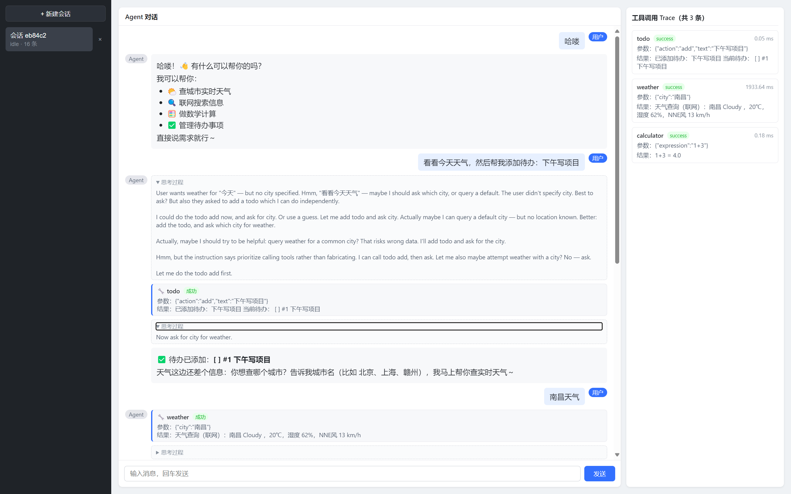

# agent-harness

A self-implementation agent harness project.

自实现 Agent harness：FastAPI 后端 + Vite/React/TS 前端，无外部 Agent 框架，自实现类 LangGraph 的循环、节点、状态机与 Runtime。



## 功能

- **主循环**：接收输入 → 判断直接回复/调用工具 → 调用工具 → 继续/终止（单次问答轮次上限 8）
- **工具注册**：name / description / 参数 Schema（JSON Schema）；内置 `calculator`（安全求值）、`search`（联网 DuckDuckGo）、`weather`（联网 wttr.in）、`todo`（待办 add/list/done）
- **LLM 输出解析**：思考/工具调用/最终答案三类；默认 MockLLM（规则式），可选 DeepSeekLLM 真实接入（`LLM_BACKEND=deepseek`，OpenAI-compatible 工具调用）
- **session 管理**：多会话隔离、可续聊、删除会话、列表空自动建默认会话、会话忙保护（HTTP 409）
- **context 管理**：轮次上限、短期记忆、追问路由；**窗口裁剪已实现**（token 估算 + `trim_messages`，上限 4000）+ 长期记忆召回；summary 摘要压缩待实现
- **流式输出**：思考过程 / 工具调用 / 回复增量事件（`/api/.../events` 轮询）；前端 AI 消息块化渲染（思考可折叠 + 工具卡内嵌 + Markdown + 打字机）
- **存储抽象**：`SessionStore` 抽象（内存 / SQLite 双实现），会话 / 消息 / trace 可落库持久化（`SESSION_STORE=sqlite`）
- **健壮性**：工具级异常兜底（含联网工具网络失败兜底）+ **工具执行超时**（`asyncio.wait_for` 默认 10s，超时转 error 结果回给 LLM）+ **记忆链路异常隔离**（召回 / 提取 / 写入失败均降级，不阻断回复与历史写回）+ 工具调用 trace（工具名/参数/结果/耗时）+ **全局中间件**（请求计时 / 未捕获异常 500 兜底不泄露堆栈 / 请求日志入库）

详细实现见 [docs/系统设计.md](docs/系统设计.md)。

## 运行方式

后端（Python 3.13）：

```powershell
# 一键构建 .venv 并安装依赖
powershell -ExecutionPolicy Bypass -File .\setup.ps1
# 默认 Mock 模式启动（8000 端口，可用 PORT 覆盖）
python src/main.py
# 接入真实 DeepSeek：参考 .env.example 创建 .env（DEEPSEEK_API_KEY / BASE_URL / MODEL_NAME），再
$env:LLM_BACKEND = "deepseek"
python src/main.py
# 可选：SQLite 落库持久化（会话/消息/trace 与请求日志，默认内存）
$env:SESSION_STORE = "sqlite"   # 数据库默认 data/agent-harness.db，可用 SESSION_DB 覆盖
$env:LOG_STORE = "sqlite"       # 请求日志同样落库（复用 SESSION_DB）
python src/main.py
```

前端（Node）：

```powershell
cd frontend
npm install
npm run dev   # 5173 端口，Vite proxy 将 /api 转发到 127.0.0.1:8000
```

契约导出：`.venv/Scripts/python.exe scripts/export_api.py` → `api.json`（OpenAPI 3.0.3）。

测试：`.venv/Scripts/python.exe -m pytest`（175 passed，实测；联网工具与真实 LLM 路径通过 monkeypatch 离线验证）。

> 注 1：Windows 端口处于 Hyper-V/WSL2 保留段（7449-8248）会报 WinError 10013，用 `$env:PORT=18000` 换端口。
> 注 2：`.env` 若配置了 `SESSION_STORE=sqlite` / `LLM_BACKEND=deepseek`，直接跑 pytest 会因环境读入导致部分用例失败；请先覆盖：
> `$env:LLM_BACKEND="mock"; $env:SESSION_STORE="memory"; $env:LOG_STORE="memory"; python -m pytest tests`

## Docker 部署（前后端分离：nginx 静态托管 + API 反代，一步到位）

前置：仅需本机安装 Docker（**无需 Node/npm**——前端在容器内多阶段构建）。

```powershell
cd agent-harness
docker compose up -d --build
```

访问 `http://localhost`：nginx（80）托管前端静态产物，`/api/` 反代到后端容器 `api:8000`。SQLite 经 `./data` 卷持久化；默认 Mock 模式零配置可跑，接真实 DeepSeek 时在 `.env` 配置 `DEEPSEEK_API_KEY` 后置 `LLM_BACKEND=deepseek` 再 `docker compose up -d`。

架构（两个镜像，compose 编排）：

- `api`：后端镜像（`Dockerfile`，python:3.12-slim，非 root 运行，healthcheck 探活 `/api/health`）；
- `nginx`：前端镜像（`frontend/Dockerfile` **多阶段**——stage1 node:20-alpine 内 `npm ci && npm run build` 出 dist，stage2 nginx:1.27-alpine 只拷 dist 与反代配置，自包含无挂载）。

关键点：

- **多阶段构建**：构建产物只存在于中间层，最终镜像不含 node/源码，体积小、宿主零 Node 依赖；
- **`proxy_buffering off`**：本项目流式输出走 `/api/.../events` 轮询 + `message_delta` 增量，nginx 缓冲会攒满才转发导致延迟/粘包；
- **非 root 运行**：后端容器用 `appuser` 运行（最小权限）；
- **SQLite 卷持久化**：`./data` 挂载，容器重建不丢会话/记忆。

## 系统设计

架构分层：FastAPI（`src/main.py`，含全局中间件）→ Agent 运行时（`src/agent/`：runtime/router/session/llm/tools/context/events/memory/log）→ 存储抽象（内存 / SQLite 双实现）；前端 `frontend/`（会话列表 + 聊天框 + trace 面板 + localStorage 缓存兜底）。

- 主循环四步流转与继续/终止判断；消息结构支持 OpenAI 兼容工具调用（tool_call_id 回显）；唯一主循环为 `async_run`（工具 handler 全部 async，联网走 `httpx.AsyncClient`），同步 `run()` 仅为测试 / 脚本的薄包装
- 工具注册表（参数 Schema + 安全校验，calculator 为 AST 白名单防注入）；search/weather 真实联网查询
- LLM 后端切换：MockLLM（默认）与 DeepSeekLLM（真实），`LLM_BACKEND` 环境变量控制；assistant 消息携带 `reasoning` 思考过程
- **流式事件**：`EventQueue` + `InMemoryQueue`（会话隔离 / 单调 seq），`GET /api/sessions/{id}/events?since=N` 轮询增量消费；前端 AI 消息块穿插式渲染 + 轮询锚点只消费本轮事件
- **存储与日志**：`SessionStore` / `LogStore` 抽象，内存默认、SQLite 可选（`SESSION_STORE` / `LOG_STORE` 环境变量）；中间件请求计时 + 异常兜底 + 日志入库
- **长期记忆**：`BM25Memory`（乘法衰减）+ `MemoryExtractor`（LLM 提取，对齐 mem0 写入管线），见下节
- trace 记录与独立面板展示 + 工具调用内嵌 AI 消息块；前端会话删除、失效自动重建、本地缓存

完整设计与各功能模块实现细节、API 契约、测试、边界与限制见 [docs/系统设计.md](docs/系统设计.md)。

## memory 召回时机与放置方式

**状态：已实现（⑦ 长期记忆）。**

- **召回时机**：每轮提问时，runtime 以本轮 user 消息为 query，经 `BM25Memory` 召回 top-k（默认 10）历史事实，随本轮请求交给 LLM；命中条目的 `access_count` 递增，按 `decay_factor^access_count` 乘法衰减抑制热门记忆霸榜
- **放置方式**：拼在 system 之后、以「【长期记忆（历史问答，仅供参考）】」段注入本次上下文，**不写回** `session.system_prompt`（静态 base 不被污染）
- **落库时机与管线**：每轮 QA 完成后经 `MemoryExtractor`（对齐 mem0/Mitta 写入管线）由 LLM 从「已有记忆 + 最近消息 + 本轮 QA」提取自包含事实、md5 去重后逐条落库；指代（如"那南昌呢"承接上文）在提取阶段消解；解析失败降级为原始 QA 单条；**LLM 调用失败 / 召回失败 / 写入失败一律降级跳过**（记忆是弱一致性的附属功能，任何一环出问题都不影响本轮回复返回与历史写回）

实现：`src/agent/memory.py` 提供插件化 `MemoryStrategy` 抽象 + `BM25Memory`（Okapi BM25 k1=1.5/b=0.75，CJK 单字+英文按词切分）；当前为内存实现，未来可换 SQLite / 向量库。详见 [docs/系统设计.md](docs/系统设计.md) 与 `docs/devlog/`。

## 后续规划

- context：summary 摘要压缩（裁剪时把被裁旧消息调 LLM 压成「历史摘要」插在 system 后，计入 token 预算、控制触发频率；见 `docs/context与记忆机制设计.md`）
- 记忆：SQLite 落库（复用 `connect_sqlite`/`sqlite_transaction` 加 memories 表）
- 工具：继续扩展真实网络查询类工具（如 fetch）
- AgentRuntime：针对性优化（状态机细化等；异步工具已落地）
- 中间件：PostgreSQL / Redis / ChromaDB 等正式启用（存储与记忆已插件化抽象，SQLite/内存实现足以支撑本地开发）
